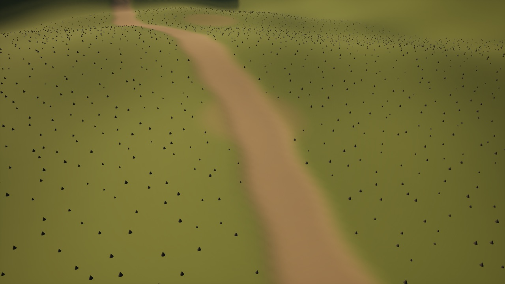
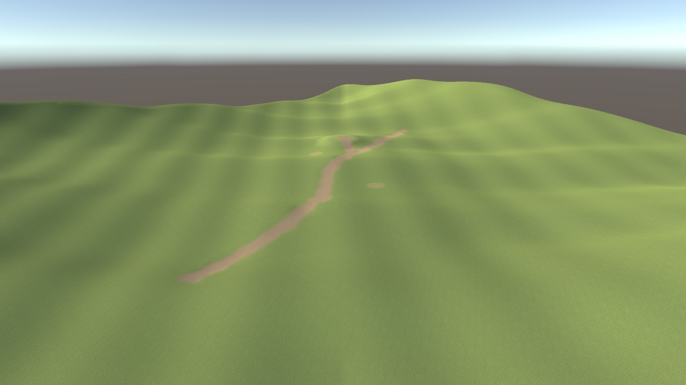

# gam3stack

**Game development kits and skills for coding agents.** Unreal Engine and Unity, one plugin per engine.

A coding agent can write game code, but it cannot see the game. gam3stack gives it the missing loop: compile,
run the real game unattended, take screenshots, read the log for what broke, and build levels from data instead of
by hand. Kits are source that is copied into your project. You own and edit it. MIT licensed, no account, no
service, no telemetry.

| Plugin | For | Kits |
| --- | --- | --- |
| `unreal@gam3stack` | Unreal Engine 5 | `ue-driver`, `editor-bridge`, `shot-director`, `world-landscape` |
| `unity@gam3stack` | Unity 6 | `unity-driver`, `shot-capture`, `terrain-from-data` |

Install only the engine you use. The two plugins share nothing at run time.

## Install

Requires **Node.js 20+** and your agent CLI. Nothing to build.

### Claude Code

```sh
claude plugin marketplace add coop-collective/gam3stack
claude plugin install unreal@gam3stack     # and/or: unity@gam3stack
```

### Codex

```sh
codex plugin marketplace add coop-collective/gam3stack
codex plugin add unreal@gam3stack          # and/or: unity@gam3stack
```

### Cursor, Gemini CLI, Windsurf and other MCP agents

Each plugin is a local stdio MCP server with no dependencies. Clone the repository, then add the server:

```json
{
  "mcpServers": {
    "gam3stack-unreal": { "command": "node", "args": ["/path/to/gam3stack/plugins/unreal/scripts/gam3.mjs", "mcp"] }
  }
}
```

The same script is a command line: `node plugins/unreal/scripts/gam3.mjs doctor | kits | kit NAME | install NAME`.

## Try it

Start a session in your game project and ask:

```text
Use gam3stack to set this Unreal project up for unattended builds and screenshots,
then show me a screenshot of the main level from the game.
```

```text
Use gam3stack to build a grassy plain with rolling hills, a dirt road and scattered
rocks as a new level. Show me what it looks like in the game.
```

```text
Use gam3stack to check that this Unity project compiles, run the edit mode tests,
and capture the main scene.
```

Claude Code also has `/unreal:doctor`, `/unreal:kit`, `/unreal:shot`, `/unity:doctor` and `/unity:kit`.

**The workflow:** inspect → plan → install → adapt → verify. An install is a plan first: every file and what
would happen to it. Nothing is written until the plan is applied, and a file you edited is never overwritten
unless you say so. Copying files is the start; the agent still adapts them to your project and runs the checks.

| Unreal: `world-landscape`, captured from the game | Unity: `terrain-from-data`, captured in batch mode |
| --- | --- |
|  |  |

Both were built from the example data files and use placeholder colours and meshes: the point is the pipeline, not the art.

## What is in a plugin

| Part | What it is |
| --- | --- |
| Kits | Scripts and engine source copied into the project: [kit format](docs/KIT-SPEC.md) |
| Skills | How to work in the engine as an agent: the build-and-look loop, building worlds from data, the pitfalls |
| MCP tools | `<engine>_doctor`, `<engine>_kits`, `<engine>_kit`, `<engine>_install` |
| Commands | Short entry points for the above |

### Unreal kits

| Kit | Gives the project |
| --- | --- |
| [`ue-driver`](plugins/unreal/kits/ue-driver/KIT.md) | Compile C++, run editor Python, run the game unattended with its log checked for failed materials and crashes |
| [`editor-bridge`](plugins/unreal/kits/editor-bridge/KIT.md) | One editor kept open and called from the shell through the engine's own MCP plugin: Python, any editor tool, viewport captures |
| [`shot-director`](plugins/unreal/kits/shot-director/KIT.md) | Screenshots from the real game at set times, optionally through a fixed camera, then quit |
| [`world-landscape`](plugins/unreal/kits/world-landscape/KIT.md) | A level from one data file: Landscape terrain, paint layers, PCG scatter, lighting; one command rebuilds it |

### Unity kits

| Kit | Gives the project |
| --- | --- |
| [`unity-driver`](plugins/unity/kits/unity-driver/KIT.md) | Batch-mode compile check with the compiler errors, run a static method, run tests and summarise the results |
| [`shot-capture`](plugins/unity/kits/shot-capture/KIT.md) | Render a scene's camera to a PNG in batch mode |
| [`terrain-from-data`](plugins/unity/kits/terrain-from-data/KIT.md) | A Terrain built from a height function and paint layers defined as data |

## What was tested

Each kit's `kit.json` has a `verified` entry saying which engine version and platform it was run on and what was
run. Read it before relying on a kit elsewhere. Short version for 0.1.0: everything was run on macOS (Apple
silicon) with UE 5.9 and Unity 6000.6. Windows and Linux code paths exist but were not run for this release.

## Scope

gam3stack is tooling for the agent's working loop. It does not ship art, characters or gameplay systems, and it
does not replace knowing the engine. Kits that grow into gameplay features (cameras, combat, UI) are welcome as
long as they come from a working game and say what they were tested on.

## Develop

```sh
git clone https://github.com/coop-collective/gam3stack.git
cd gam3stack
npm run check        # sync check, validation, tests (no install needed: there are no dependencies)
```

`core/` holds the kit installer, the command line and the MCP server. Each plugin carries a copy in
`scripts/lib/`, because agents install a plugin as its own directory. After changing `core/`, run `npm run sync`.

Contributing a kit: take it from code that works in a real project, follow the [kit format](docs/KIT-SPEC.md),
state its limits in `KIT.md`, and fill `verified` with what you ran.

[Kit format](docs/KIT-SPEC.md) · [MIT license](LICENSE)
